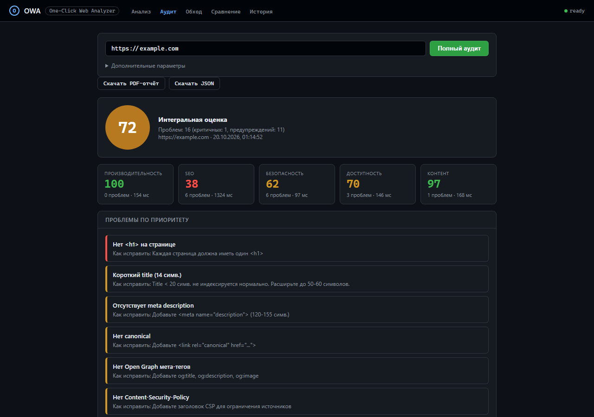

# OWA — One-Click Web Analyzer

> **Статус:** пет-проект в портфолио. Не для продакшена.
> **Зачем:** демонстрация работы с Performance API, Playwright, MCP, SSRF-защитой и AI-интеграцией.

[](https://github.com/maf1kkk/OWA/actions/workflows/test.yml)


Вставляешь ссылку — получаешь **комплексный аудит сайта**: производительность, SEO,
безопасность, доступность, контент, обход страниц, сравнение с конкурентами и
клиентский PDF с графиками. Работает локально, из CLI, из веб-интерфейса и как
MCP-инструмент для ИИ-агентов.

```bash
node bin/owa.js audit --full https://example.com          # JSON: 5 секций + оценка
node bin/owa.js report --pdf report.pdf --url https://example.com   # клиентский PDF
node bin/owa.js crawl https://example.com --max-pages 10 # обход сайта
node bin/owa.js compare --target https://site.com --with https://rival.com
```

---

## Демо

**Веб-интерфейс — вкладка «Аудит»** (оценка по разделам, проблемы с рекомендациями, выгрузка PDF):



**Пример клиентского PDF-отчёта** (титул с оценкой и радаром, Core Web Vitals,
топ-10 проблем, графики, план работ):

[Скачать sample-audit-report.pdf](docs/sample-audit-report.pdf) · 202 КБ

**Сравнительный отчёт** (клиент против конкурентов):

```bash
node bin/owa.js compare --target https://site.com --with https://rival-a.com,https://rival-b.com --pdf compare.pdf
```

## Возможности

| | Что делает | Команда |
|---|---|---|
| **Performance** | Core Web Vitals (LCP, CLS, FCP, TTFB, TBT), Long Tasks, ресурсы, водопад загрузки, JS-ошибки | `owa <URL>` |
| **Комплексный аудит** | 5 секций параллельно на одном Playwright-контексте, интегральная оценка 0–100 | `owa audit --full <URL>` |
| **SEO** | title, description, canonical, Open Graph, H-структура, alt, битые ссылки, robots.txt | в составе аудита |
| **Безопасность** | CSP, HSTS, X-Frame-Options, X-Content-Type-Options, Referrer-Policy, mixed content | в составе аудита |
| **Доступность** | axe-core: нарушения с селекторами, severity critical/warning/info | в составе аудита |
| **Контент** | пустые ссылки, дубли заголовков, длина title, structured data, объём текста | в составе аудита |
| **Обход сайта** | краулер по внутренним ссылкам + разбор `sitemap.xml` (с индексами), агрегаты по сайту | `owa crawl <URL>` / `owa sitemap <URL>/sitemap.xml` |
| **Сравнение** | клиент против 1–5 конкурентов: таблица «метрика на сайт», выводы «где проигрываете» | `owa compare --target <URL> --with <url1>,<url2>` |
| **PDF-отчёт** | титул с радаром, Core Web Vitals с порогами, топ-10 проблем, графики, футер | `--pdf report.pdf` |
| **Клиентский текст (LLM)** | резюме для руководства и план работ через GLM/OpenAI-совместимый API, **с проверкой фактов** | `--ai --client <slug>` |
| **Веб-интерфейс** | пять вкладок: Анализ, Аудит, Обход, Сравнение, История с графиками | `npm start` |
| **MCP-сервер** | инструмент `analyze_url` для ИИ-агентов, standalone (без БД и .env) | `npm run mcp` |
| **Статический анализ кода** | CSS/HTML/JS: csstree-validator, html-validate, espree | `--code` |
| **Diff-режим** | сравнение с baseline, регрессии подсвечиваются (exit 1) | `--baseline file.json` |

## Почему OWA

- **Детерминированная интерпретация.** Вердикты и рекомендации считаются по
  фиксированным правилам в `src/interpret.js`, а не выдумываются моделью.
  LLM может только **сформулировать** вывод из уже измеренных фактов.
- **Взвешенная оценка 0–100.** Core Web Vitals и JS-ошибки весят больше, чем
  количество ресурсов: сайт с хорошими LCP/CLS/TTFB не получает 15/100 из-за
  трёх второстепенных находок.
- **Изоляция сбоев.** Упавшая секция аудита не роняет остальные — она получает
  `status: "failed"`, а отчёт всё равно формируется.
- **SSRF-защита по умолчанию.** DNS резолвится один раз, адрес проверяется и
  **пинится в сокет** (закрывает DNS-rebinding), каждый редирект перепроверяется.
  Приватные адреса и cloud metadata заблокированы.
- **MCP «из коробки».** ИИ-агент получает `analyze_url` как встроенный инструмент:
  дешевле и надёжнее, чем просить агента оценить сайт «по памяти».
- **Один бинарник.** Без облака и аккаунтов: `node bin/owa.js` работает локально.

Честно: OWA — не замена Lighthouse CI для продакшн-мониторинга. Это демонстрация
того, как собирать реальные метрики через Playwright и интерпретировать их
детерминированно, без галлюцинаций.

---

## Требования

- **Node.js 24.0.0 или новее** (https://nodejs.org). Node 24 обязателен:
  `ssrf-guard` и `chartjs-node-canvas` требуют его
- Интернет при первой установке (npm + Chromium Playwright)
- Windows / Linux / macOS

## Установка и запуск

```bash
# Windows
start.bat

# Linux / macOS
sh start.sh
```

Скрипт идемпотентен: проверяет Node, ставит зависимости, доставляет Chromium
Playwright, создаёт `.env` из `.env.example` и запускает сервер на
`http://localhost:3210`.

Ручная проверка окружения:

```bash
npm run check-env              # только проверить
node scripts/check-env.js --fix # проверить и доставить недостающее
```

Если CDN Playwright недоступен, Chromium не скачается — OWA всё равно запустится
на системном Chrome или Edge (тот же движок). Канал фиксируется через
`OWA_BROWSER_CHANNEL=chrome` или `msedge`.

### Конфигурация (.env)

При первом запуске создаётся `.env` из `.env.example`. Ключевые переменные:

| Переменная | Назначение |
|---|---|
| `PORT` / `HOST` | порт и интерфейс. Без пароля наружу не пустит — см. «Безопасность» |
| `AUTH_LOGIN` / `AUTH_PASSWORD_HASH` | Basic Auth (bcrypt-хэш пароля) для UI и API |
| `API_BEARER_TOKEN` | Bearer-токен для `/api/*` (скрипты, ИИ-агенты) |
| `OWA_BROWSER_CHANNEL` | пусто — Chromium из кэша Playwright, иначе системный Chrome/Edge; либо явно `chrome` / `msedge` |
| `OWA_ALLOW_PRIVATE_TARGETS` | `1` — разрешить анализ приватных адресов (локальная разработка). По умолчанию запрещены |
| `OWA_DENY_PRIVATE_TARGETS` | `1` — запретить приватные адреса (для старого режима проверки URL) |
| `OWA_MAX_CONCURRENT` | максимум одновременных анализов (по умолч. 2) |
| `OWA_RATE_LIMIT_MAX` / `OWA_RATE_LIMIT_WINDOW_MS` | rate limit на `/api/*` по IP (20 за 60 с, `0` — отключить) |
| `OWA_RETENTION_DAYS` | срок хранения анализов и кэша AI (30, `0` — без ограничений) |
| `AI_PROVIDER` | LLM-провайдер: `openai` / `anthropic` / `ollama` / `glm` / `none` |
| `AI_API_KEY`, `AI_BASE_URL`, `AI_MODEL` | доступ к LLM (любой OpenAI-совместимый endpoint) |
| `AI_THINKING` | `0` — выключить режим размышления GLM (быстрее), `1` — включить |
| `OWA_SCHEDULE_URLS` | список сайтов для планировщика (`scripts/scheduled.js`, cron / GitHub Actions) |

```bash
# хэш пароля для .env
node -e "require('bcrypt').hash('ВАШ_ПАРОЛЬ', 10, (e,h)=>console.log(h))"
```

`.env` не попадает в git.

---

## Использование из CLI

```bash
# Базовый анализ производительности — отчёт в консоль
node bin/owa.js https://example.com

# Полный аудит пяти секций
node bin/owa.js audit --full https://example.com --out audit.json

# Клиентский PDF (с AI-резюме и планом работ)
node bin/owa.js report --pdf report.pdf --url https://example.com --ai --client clinic

# Обход сайта и sitemap
node bin/owa.js crawl https://example.com --max-pages 10 --max-depth 2
node bin/owa.js sitemap https://example.com/sitemap.xml --max-pages 10

# Сравнение с конкурентами
node bin/owa.js compare --target https://client.com --with https://rival-a.com,https://rival-b.com --pdf compare.pdf

# Машинночитаемый вывод для ИИ-агентов
node bin/owa.js https://example.com --json
node bin/owa.js https://example.com --compact          # минимум токенов

# Diff-режим: регрессии -> exit 1
node bin/owa.js https://example.com --baseline baseline.json --threshold 5
```

### Все опции CLI

| Опция | Описание |
|---|---|
| `--json` | Только JSON-вывод (для ИИ-агентов) |
| `--compact` | Компактный JSON с готовой интерпретацией (минимум токенов) |
| `--out <файл>` | Сохранить полный JSON-отчёт |
| `--md <файл>` | Сохранить Markdown-отчёт |
| `--pdf <файл>` | Сохранить PDF-отчёт (команды `report` и `compare`) |
| `--url <URL>` | Целевой URL (команда `report`) |
| `--target <URL>` | Сайт клиента (команда `compare`) |
| `--with <url1>,<url2>` | Конкуренты через запятую (команда `compare`) |
| `--ai` | Клиентский текст отчёта через LLM (с проверкой фактов) |
| `--client <slug>` | Профиль клиента из `clients/<slug>.json` (тон, фокус, конкуренты) |
| `--full` | Полный аудит (команда `audit`) |
| `--max-pages` / `--max-depth` / `--delay` | Параметры обхода сайта (страниц, глубина, пауза мс) |
| `--ignore-robots` | Не соблюдать robots.txt при обходе |
| `--no-audit` | Только собрать список URL, без аудита страниц |
| `--selector <sel>` | Селектор виджета для пользовательской метрики (повторяемо) |
| `--wait <мс>` | Ожидание после `load` (по умолч. 5000) |
| `--timeout <мс>` | Таймаут навигации (по умолч. 60000) |
| `--headed` | Показать окно браузера |
| `--console` | Перехватить console-сообщения страницы |
| `--code` | Добавить статический анализ кода (CSS/HTML/JS) |
| `--baseline <файл>` | Сравнить с сохранённым baseline |
| `--threshold <N>` | Порог регрессии в % для `--baseline` (по умолч. 5) |

### Exit-коды

- `0` — метрики в норме
- `1` — есть проблемы (load > 5 с, > 5 долгих задач, LCP > 4 с, ошибки статанализа, регрессии)
- `2` — ошибка анализа

---

## Веб-интерфейс

`npm start` → `http://localhost:3210`. Пять вкладок:

- **Анализ** — метрики загрузки, ресурсы, водопад, Long Tasks
- **Аудит** — 5 секций, интегральная оценка, проблемы с рекомендациями, «Скачать PDF»
- **Обход** — агрегаты по сайту, таблица страниц, топ проблем по частоте
- **Сравнение** — «метрика на сайт», отставание по разделам, выводы, PDF
- **История** — прошлые анализы и графики метрик во времени

---

## MCP-сервер (для ИИ-агентов)

```json
{
  "$schema": "https://opencode.ai/config.json",
  "mcp": {
    "servers": {
      "owa": { "type": "local", "command": ["node", "mcp/server.js"], "cwd": "." }
    }
  }
}
```

Инструмент `analyze_url` возвращает **уже интерпретированный** отчёт
(компактный JSON с вердиктами и рекомендациями) — агенту не нужно оценивать
производительность по памяти. Работает standalone: без SQLite, Express и `.env`.

---

## HTTP API

| Метод | Путь | Назначение |
|---|---|---|
| `GET` | `/` | Веб-интерфейс |
| `GET` | `/health` | `{ status, version, uptime }` |
| `GET` | `/api/health` | `{ ok, tool }` |
| `POST` | `/api/analyze` | Performance-анализ: `{ url, selectors?, waitMs?, timeoutMs?, headed?, consoleLogs?, compact?, save? }` |
| `POST` | `/api/audit` | Полный аудит 5 секций: `{ url, waitMs?, timeoutMs? }` |
| `POST` | `/api/crawl` | Обход сайта: `{ url, maxPages?, maxDepth?, delayMs?, respectRobots? }` |
| `POST` | `/api/compare` | Сравнение: `{ target, competitors[], delayMs? }` |
| `GET` | `/api/report/pdf?type=audit\|compare&id=<id>` | PDF по готовому отчёту (без повторного аудита) |
| `POST` | `/api/code-analysis` | Статический анализ кода с продолжением (сессии) |
| `POST` | `/api/ai/explain` | AI-объяснения находок статанализа |
| `GET` | `/api/history?limit&offset&url` | Список анализов |
| `GET` | `/api/history/metrics?limit&url` | Метрики во времени (для графиков) |
| `GET` | `/api/history/diff?id1&id2` | Сравнение двух анализов |
| `GET` | `/api/history/:id` | Детали анализа (+ `codeFindings`) |
| `DELETE` | `/api/history/:id` | Удалить запись (каскадно) |
| `DELETE` | `/api/history` | Очистить историю целиком |

Ошибки — всегда JSON `{ error: CODE, message: string }` + корректный HTTP-статус.

---

## Архитектура

```
Заказ / API / CLI
   └─> валидация URL + SSRF-защита (safeFetch: пининг IP, перепроверка редиректов)
        └─> AuditOrchestrator (p-queue: параллелизм, p-retry: повторы)
             └─> 5 секций на ОБЩЕМ Playwright-контексте
                  performance | seo | security | accessibility | content
             └─> нормализация -> integralScore (взвешенная оценка)
                  └─> PDF (Playwright page.pdf + PNG-графики) и/или JSON
                       └─> клиентский текст (LLM) — только из проверенных фактов
```

| Файл | Назначение |
|---|---|
| `src/core/orchestrator.js` | Ядро: параллельный запуск секций, изоляция ошибок, интегральная оценка |
| `src/audit/session.js` | Общий Playwright-контекст аудита (одно открытие страницы на все секции) |
| `src/audit/sections.js` | Секции: performance, seo, security, accessibility, content |
| `src/interpret.js` | Детерминированная интерпретация: вердикты, рекомендации, оценка |
| `src/security/safe-fetch.js` | Единый исходящий запрос: SSRF-защита, пининг IP, перепроверка редиректов |
| `src/crawl/` | Краулер, sitemap, robots.txt, агрегаты по сайту |
| `src/compare/` | Сравнение с конкурентами: таблицы и текстовые выводы |
| `src/report/pdf.js`, `src/report/compare-pdf.js` | PDF-отчёты |
| `src/ai/rag.js` | Поиск по базе знаний (BM25-подобный, офлайн) |
| `src/ai/report-generator.js` | Факт-лист → промпт → проверка фактов → текст |
| `src/ai/knowledge/` | База знаний: пороги, ГОСТ, приёмы, юридические ограничения |
| `src/collectors/` | Performance API, Long Tasks, Core Web Vitals, виджеты |
| `web/` | Express-сервер, веб-интерфейс, API, авторизация, rate limit |

### Клиентский текст через LLM (RAG)

```bash
node bin/owa.js report --url https://client.com --pdf report.pdf --ai --client clinic
```

1. **Факт-лист** — только измеренные значения и реальные находки.
2. **RAG** — из `src/ai/knowledge/` подтягиваются релевантные выдержки: пороги
   CWV, SEO-ориентиры, заголовки безопасности, WCAG 2.1 и **ГОСТ Р 52872-2019**,
   приёмы по правке, структура отчёта и юридические ограничения.
3. **Профиль клиента** (`clients/<slug>.json`) — тон, фокус, отрасль, конкуренты.
   Влияет только на формулировки, **не может** изменить ни одну цифру.
4. **Проверка фактов** — все числа должны быть в фактах или в базе знаний, все
   `ruleId` — среди реальных находок. Не прошло — берётся детерминированный текст.

Без `--ai` (или если LLM недоступна) отчёт полностью детерминирован.

---

## Безопасность

### Авторизация

Без настройки сервер приватный: слушает только `127.0.0.1`. Попытка запустить
с `HOST=0.0.0.0` **без пароля завершается ошибкой**.

| Переменная | Что даёт |
|---|---|
| `AUTH_LOGIN` + `AUTH_PASSWORD_HASH` | Basic Auth (bcrypt) для UI и API |
| `API_BEARER_TOKEN` | Bearer-токен для `/api/*` — для скриптов и ИИ-агентов |

Сравнение Bearer-токена тайминг-защищённое, пароль — через `bcrypt.compare`.
`/health` и `/api/health` открыты всегда.

### Защита от SSRF

OWA открывает **чужие** страницы, поэтому все исходящие запросы идут через
`src/security/safe-fetch.js`:

- только `http` / `https`;
- DNS резолвится **один раз**, адрес проверяется и **пинится в сокет** —
  окно TOCTOU/DNS-rebinding закрыто (`ssrf-guard`);
- **каждый редирект перепроверяется** — публичный URL, редиректящий на
  `10.0.0.1` или `169.254.169.254`, блокируется;
- приватные диапазоны, `localhost`, `*.local`, `*.internal` и cloud metadata
  запрещены **по умолчанию** (`OWA_ALLOW_PRIVATE_TARGETS=1` — только локальная разработка);
- заблокированные попытки логируются с URL и причиной;
- URL ресурсов **со страницы** — только `http(s)` и только с того же origin;
  `file://` запрещён категорически.

Распознаются и обфусцированные формы `http://2130706433/`, `http://0x7f000001/`,
восьмеричные записи.

Дополнительно: один URL не анализируется дважды параллельно, не больше
`OWA_MAX_CONCURRENT` одновременных запусков (дальше — `429`), видимый браузер
через API только с `OWA_ALLOW_HEADED=1`, тело запроса ≤ 1 МБ, наружу не
утекают внутренние сообщения об ошибках.

**Rate limit:** `20` запросов `/api/*` на IP за `60` секунд
(`OWA_RATE_LIMIT_MAX` / `OWA_RATE_LIMIT_WINDOW_MS`), дальше — `429` с
`Retry-After`. Лимит не касается UI и `/health`.

---

## База данных

SQLite (`better-sqlite3`) в `data/owa.db` (каталог создаётся сам, в git не попадает):

- режим **WAL**, `foreign_keys = ON`;
- миграции — SQL-файлы `src/db/migrations/NNN_*.sql`, применяются по `PRAGMA user_version`;
- вручную: `npm run migrate`;
- таблицы: `analyses` (история), `code_findings`, `code_sessions`, `ai_responses` (кэш LLM), `settings`.

**Обслуживание** (раз в 6 часов): удаление анализов, кэша AI и завершённых
сессий старше `OWA_RETENTION_DAYS` (по умолч. 30), чекпоинт WAL.

---

## Тесты

```bash
npm test                              # все тесты
node --test test/interpret.test.js    # правила интерпретации
node --test test/audit.test.js        # комплексный аудит
node --test test/crawl.test.js        # обход сайта и sitemap
node --test test/compare.test.js      # сравнение с конкурентами
node --test test/ssrf.test.js         # SSRF-защита
node --test test/ai-report.test.js    # RAG, проверка фактов, fallback
node --test test/cli.test.js          # CLI (есть сетевые тесты)
node --test test/mcp.test.js          # MCP-сервер (есть сетевые тесты)
```

**178 тестов**: граничные случаи, стабильность схемы JSON, недоступные сайты и
невалидные URL, живучесть MCP-сервера, миграции и репозитории SQLite, HTTP-роуты,
правила статанализа CSS/HTML/JS, циклы сессий `POST /api/code-analysis`, AI-слой
(кэш, retry, таймаут) на мок-сервере, diff-режим, оркестратор (изоляция ошибок,
таймауты, лимит параллелизма), аудит, краулер, сравнение, PDF, SSRF и RAG.

> Сетевые тесты CLI/MCP требуют установленного Chromium (`npx playwright install
> chromium`) — `start.bat` делает это сам.

### Откат без Git

Модули 0–5 и AI-слой можно откатить локально, без истории Git:

```bash
scripts\rollback-audit-modules.bat    # Windows
sh scripts/rollback-audit-modules.sh  # Linux/macOS
```

Скрипт восстанавливает изменённые файлы из `.rollback-backup/original` (каталог
вне Git) и удаляет добавленные модули.

---

## Структура проекта

```
bin/owa.js                 CLI: audit, report, crawl, sitemap, compare
mcp/server.js              MCP-сервер для ИИ-агентов
src/core/                  оркестратор аудита
src/audit/                 секции аудита и общий Playwright-контекст
src/crawl/                 краулер, sitemap, robots
src/compare/               сравнение с конкурентами
src/ai/                    LLM-слой: RAG, база знаний, генерация и проверка фактов
src/security/              SSRF-защита, safeFetch
src/report/                PDF-отчёты
src/collectors/            сбор метрик (Performance API, Long Tasks, CWV)
src/static-analyzer/       статический анализ CSS/HTML/JS
src/db/                    SQLite, миграции, репозитории
web/                       Express-сервер и веб-интерфейс
templates/                 шаблоны PDF-отчётов
clients/                   профили клиентов (тон, фокус, конкуренты)
test/                      178 тестов (node:test)
```

## Лицензия

MIT — см. [LICENSE](LICENSE).
